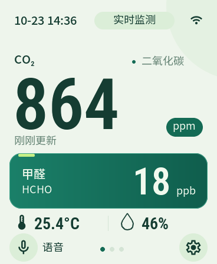
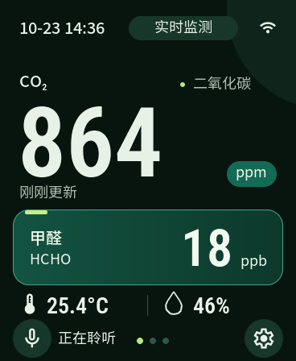

# ESP32-AirSense

基于 [小智 ESP32](https://github.com/78/xiaozhi-esp32) 的空气检测仪：微雪 **ESP32-S3-Touch-AMOLED-1.8 初版 / V1**，搭配 SCD41 CO₂ 和 SFA40 甲醛模块，提供本地仪表、浓度提醒、可选语音和 Home Assistant 分钟历史。

这是个人 DIY 工程，目前只适配上述 V1 板卡，**不适用于 V2**。源码、界面和结构模型持续迭代；请按自己的传感器转接板和原壳确认供电、尺寸与装配。

| 日间读数 | 夜间读数 | 小智对话 |
| --- | --- | --- |
|  |  |  |

以上由当前源码的原生 LVGL 测试渲染，使用测试数据展示读数与对话布局，不是实测浓度或当前设备照片。

## 功能

- **离线空气检测**：CO₂、甲醛及 SCD41 温湿度；无效、预热、稳定和过期数据分别显示。
- **适配小屏幕的界面**：读数、最近 30 分钟历史、设置和对话页；日间 / 夜间 / 自动主题、亮度、音量、静音与减少动态。
- **浓度提醒**：主页状态与数字颜色分级、每轮可选短提示音，可调整阈值及开关；不弹出告警页、不抢占对话、不唤醒屏幕。
- **按键与关机**：BOOT 回主页，PWR 短按亮灭屏、长按请求关机；配网需要屏幕确认。
- **可选小智语音**：点击或唤醒进入对话，可独立停止；结束空闲后返回仪表，语音功能可关闭。
- **可选 Home Assistant**：HTTPS 上传每分钟平均、最高、最低与样本数；HA 自定义集成保存分钟记录并绘制历史曲线。
- **AirDock 60 结构**：屏幕倾斜 60°、水平传感器舱、开放走线槽，提供 CAD 源码、STEP、STL 和 Bambu Studio 工程。

## 硬件

| 部件 | 要求 |
| --- | --- |
| 主板 / 屏幕 | ESP32-S3-Touch-AMOLED-1.8 V1，368×448，16 MB Flash / 8 MB PSRAM |
| CO₂ 模块 | SCD41，I²C 地址 `0x62` |
| 甲醛模块 | SFA40，I²C 地址 `0x5D` |
| 供电 | USB 5 V；传感器接受控 3.3 V 电源，确认转接板支持 3.3 V 供电及逻辑电平 |

两个传感器共用 I²C。焊接前请读[接线、备份与刷写说明](doc/接线与刷写说明.md)，按 TP 编号核对；**TP2 是 VBUS，不能当作 3.3 V**。

## 开始使用

1. 确认硬件是 V1，备份原设备完整 Flash。
2. 按[板型说明](main/boards/custom/waveshare-air-monitor-1.8-v1/README.md#编译入口)安装固定 ESP-IDF 与 ESP32-S3 工具链。当前基线为 ESP-IDF `release/v6.1` commit `9a97f6c54ec638111ce55cd36581b3c192f15207`。
3. 在仓库根目录构建：

```sh
source /path/to/esp-idf/export.sh
bash scripts/build_air_monitor.sh
```

需要 Node / npm；脚本安装锁定版本的字体工具，首次解析组件需要联网。`dependencies.lock` 随源码保存，不手改 `managed_components/`、生成字体或 `sdkconfig`。

应用输出为 `build/xiaozhi.bin`，完整刷写清单为同次构建的 `build/flash_args` / `build/flasher_args.json`。按[刷写步骤](doc/接线与刷写说明.md#三安装固件)操作，不混用不同构建的镜像，也不要默认固定写某个 OTA 地址。

**空气检测不需要 HA 配置。** 未创建 `.air-ha/credentials.json` 时构建会禁用 HA 上传；需要时再按[板型 HA 配置](main/boards/custom/waveshare-air-monitor-1.8-v1/README.md#ha-分钟上报配置)和[HA 集成说明](homeassistant/README.md)配置自己的服务与每设备独立密钥。配置过密钥的固件包含该密钥，不应直接公开分发。

## 文档入口

| 内容 | 入口 |
| --- | --- |
| 接线、原机备份、刷写与按键 | [使用说明](doc/接线与刷写说明.md) |
| 构建、传感器协议、配置及验证边界 | [板型 README](main/boards/custom/waveshare-air-monitor-1.8-v1/README.md) |
| HA 安装、鉴权、分钟库和看板 | [HA README](homeassistant/README.md) |
| 最新分舱结构与打印配置 | [AirDock 60](doc/enclosure/airdock-60/README.md) |
| 文档、预览及历史设计记录 | [文档索引](doc/README.md) |
| 贡献方式及本地检查 | [CONTRIBUTING.md](CONTRIBUTING.md) |
| 第三方许可与素材来源 | [THIRD_PARTY_NOTICES.md](THIRD_PARTY_NOTICES.md) |
| 自动主题与提醒策略 | [行为说明](doc/自动主题与提醒.md) |

自动主题需要手动选用，依据 HA 家庭位置与本次开机取得的 UTC 判断日夜；首次使用需配置 HA，缺位置或时间时保持当前主题。[位置数据流与离线限制](doc/自动主题与提醒.md)。

## 目录

| 路径 | 内容 |
| --- | --- |
| `main/boards/custom/waveshare-air-monitor-1.8-v1/` | 本项目板型、界面、采集、告警、按键与 HA 上传 |
| `main/`、`cmake/` | 小智应用、音频、协议、公共板级逻辑及 AIR 构建适配 |
| `scripts/`、`tests/air_monitor/` | 构建、资源生成和主机验证 |
| `homeassistant/` | HA 自定义集成、分钟看板及测试 |
| `doc/` | 本项目说明、CAD、预览与开发记录 |
| `docs/` | 保留的上游协议与开发参考 |

上游板型目录仍由构建系统引用，保留以便追溯与维护。自动板型构建目前暂停；现有手动工作流面向上游多板型矩阵，不能代替上述 AIR 专用构建入口。

## 已知限制

- 温湿度来自 SCD41；主板发热、外壳、安装位置和日晒都会影响读数。尚未完成装壳后的温升标定，不能把读数直接视为准确室温。
- 本地 30 分钟历史和待上传队列位于 RAM，断电会丢失；已经收到并保存到 HA 的分钟记录保留在 HA 侧，仍需备份与磁盘管理。
- AirDock 60 提供试装工程；SFA40 模块包络等部分尺寸仍有估计值，原壳配合、支撑拆除、耐温与隔热效果需要自行验证。
- 编译、主机测试和界面预览不代替真实传感器、供电、关机及车内并发场景验收。

## 来源与许可

基于小智 commit `7e69845d818553ac045efbcde746b22bef6eecf6`。保留原 [MIT 许可证](LICENSE)及版权声明；字体、带独立许可的源码、下载组件和厂商资料各自遵守原许可，见[第三方说明](THIRD_PARTY_NOTICES.md)。公开源码范围及来源见 [doc/provenance/](doc/provenance/)。
