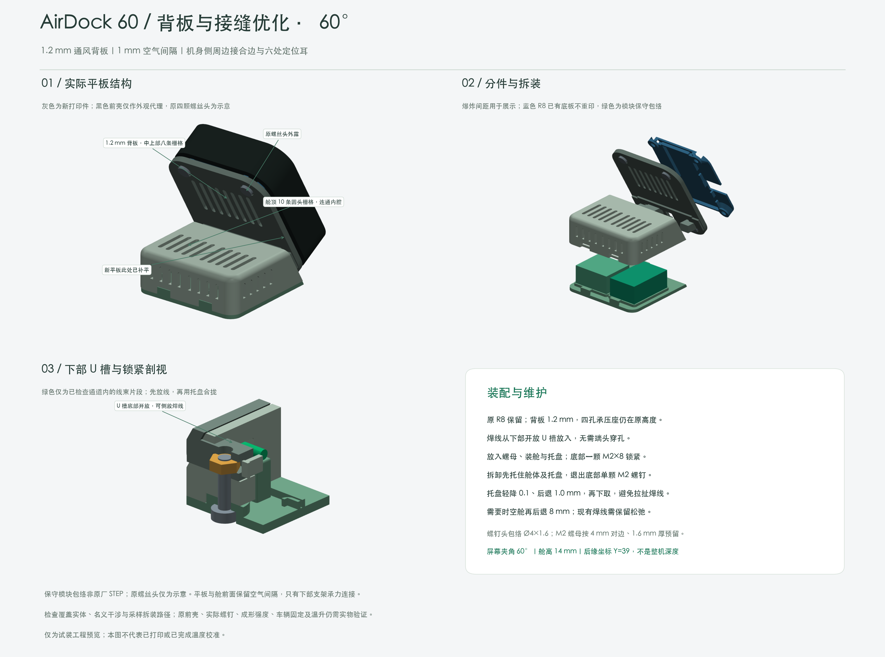
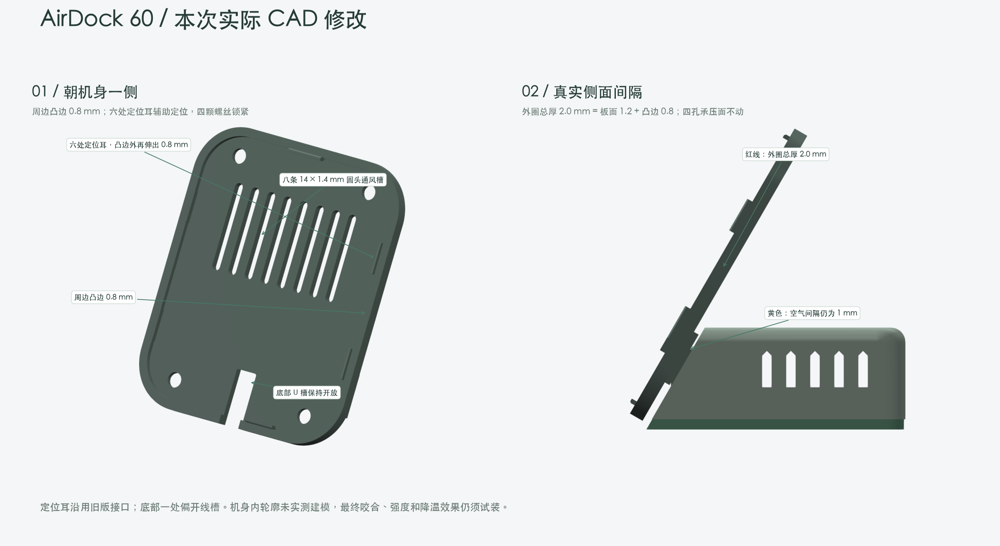

# AirDock 60｜分舱底座



针对微雪 V1 原前壳的三件式试装结构：屏幕与水平面成 **60°**，传感器放在水平舱内，已焊好的线束由开放 U 槽放入，无需拆焊穿线。

## 模型与装配

- [MOUNT 背板/支架](AirDock60_MOUNT.stl)、[BAY 传感器舱](AirDock60_BAY.stl)、[TRAY 托盘](AirDock60_TRAY.stl)，同名 STEP 保留装配坐标。
- 背板主体厚 **1.2 mm**，朝机身侧周边凸边 **0.8 mm**，外圈合计 **2.0 mm**；六处定位耳另向机身侧伸出。
- 背板与水平舱法向空气间隔 **1.0 mm**；背板中上部八条 14×1.4 mm 通风槽，舱顶与侧面保留通风孔。
- 四孔中心距 **24×36 mm**，通孔 Ø2.4 mm，四孔承压高度保留原螺丝旋入余量。原螺丝头与原壳接口仍需按实物核对。
- 复用 [R8 冻结底板](../r8-wide-base/R8_BASE.stl)和原四颗螺丝；舱体另需 M2×8 盘头螺丝及 M2 六角螺母。
- 模块包络：SCD41 转接板 21.6×13.4×9 mm；SFA40 采用 17×15×9 mm 估计包络。焊点、线束与实际转接板尺寸应重新确认。



这是结构参考与试装工程。几何检查不等于原壳卡合、强度、耐温或温度补偿已通过。分舱和通风有助于减少热耦合，但不能据此承诺温湿度已达到环境测量精度。

## 打印

[H2D 双材料 Bambu Studio 工程](AirDock60_BambuStudio.3mf)包含三件各一份：MOUNT 平放、定位耳向下；BAY 顶面向下；TRAY 底面向下。工程无缓存 G-code，必须重新切片并核对自己的机型和耗材。

工程基线为双 0.4 mm 标准流量喷嘴、纹理 PEI、0.20 mm Standard，右侧 Generic PETG 打印主体及支撑骨架，左侧 Support for PLA/PETG 仅打印接触层。板面下仍有约 1.6 mm 悬空区，需要支撑；这不是可直接关闭支撑的平板。

材料与喷嘴映射是工程配置，不是对你的 AMS 槽位的自动识别。预设温度需与实际材料匹配，支撑拆除后的表面和原壳配合需要试装。不要直接使用别人导出的 G-code。

## 源码与生成链

安装 CadQuery 后（本轮检查环境为 2.8.0），几何与检查入口为：

```sh
python doc/enclosure/airdock-60/AirDock60_CAD.py
python doc/enclosure/airdock-60/AirDock60_CHECK.py
```

`AirDock60_PACK.py` 与 `AirDock60_SUPPORT_PACK.py` 负责工程打包；`AirDock60_SUPPORT_toolpath_check.py` 检查重新切片后导出的 G-code。它们不会发送打印任务。

公开目录保留生成链需要的 R6 / R9 / R10 / R11 / R12 helper、R12 模板和 R8 STEP/STL。**R8 是冻结的已试装接口输入**，这里不提供其完整旧版再生成流程；当前 AirDock 几何可基于它重建。

工程打包包含随机 UUID 和生成日期，重新打包不会复现现有 3MF 的逐字节哈希。支撑打包脚本固定校验基线 3MF 与 STEP 的哈希；改模型或重打包后须先复核，再明确更新对应守卫，不能关掉检查继续生成。

`AirDock60_PACK_check.json` 是支撑打包和刀路检查的输入；`AirDock60_ASSEMBLY_check.json` 是预览门槛。Git 文件时间戳不能证明几何新鲜度，预览前按 CAD → CHECK → PREVIEW 运行。预览还依赖 VTK、NumPy、Matplotlib 及 macOS STHeiti 系统字体，其他系统需适配字体；几何和打包不需要连接打印机。
